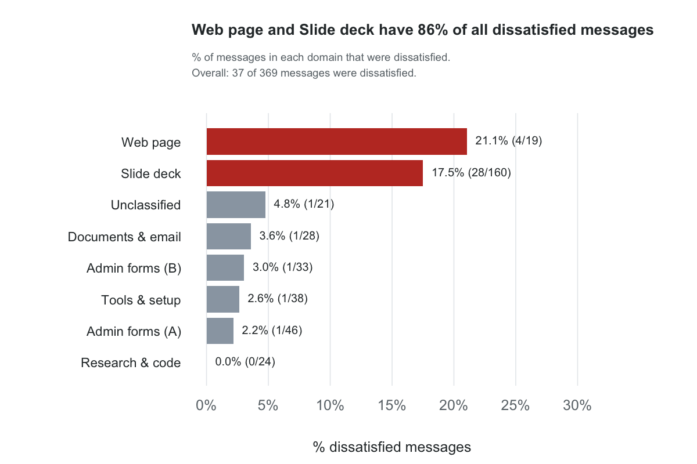
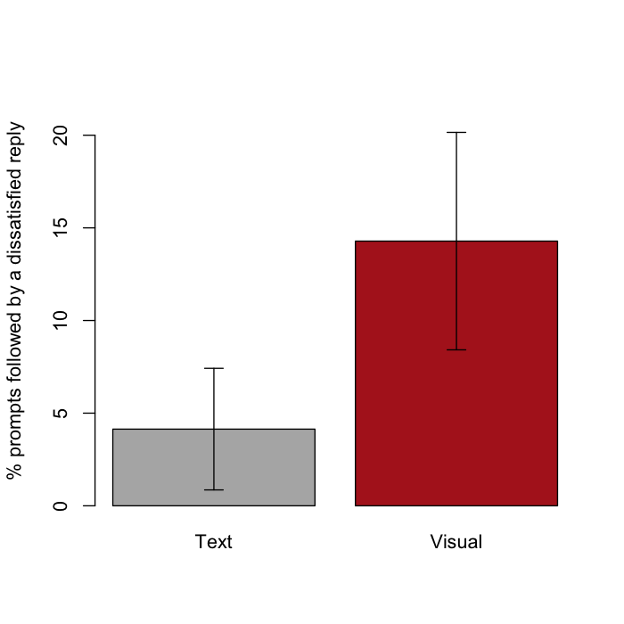
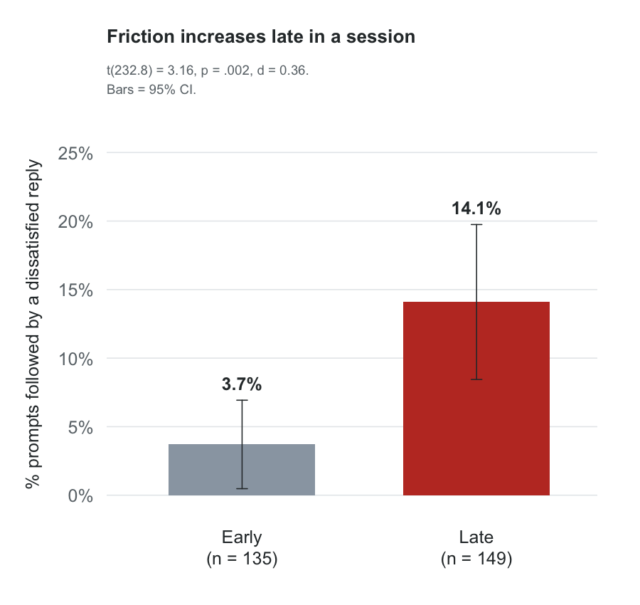
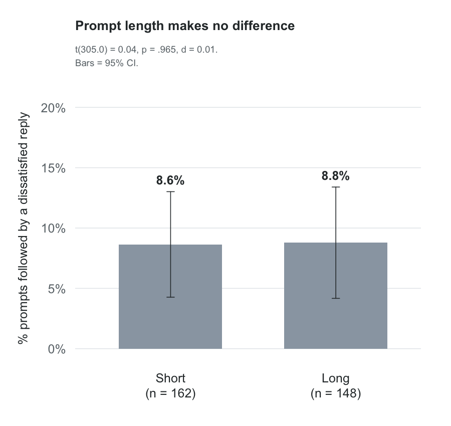
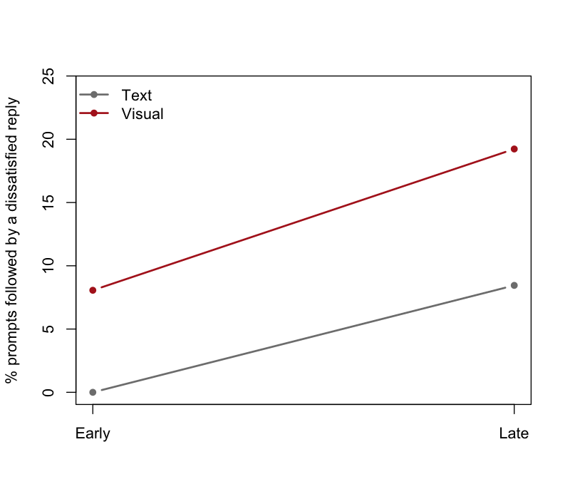

# Agent Friction Study

A self-study of friction between one user and an AI coding agent (Claude Code).
The study finds **when the user is dissatisfied with the agent's work**, and tests why.

Python prepares the data. R does the statistics. Reports follow APA style (7th ed.).
Report text follows ASD-STE100 (Simplified Technical English).

## Question
Which factors cause more dissatisfied replies from the user?

## Findings
| Factor | Result | File |
|---|---|---|
| Where friction occurs | Web page and slide work have 86% of all dissatisfied messages. | [1_descriptive](results/1_descriptive.md) |
| Prompt length | No effect (8.6% short vs 8.8% long). | [2a_ttest_length](results/2a_ttest_length.md) |
| Output type | Visual prompts get more dissatisfied replies (14.3% vs 4.1%, *p* = .003). Small effect. | [2b_ttest_visual](results/2b_ttest_visual.md) |
| Session stage | Late prompts get more dissatisfied replies (14.1% vs 3.7%, *p* = .002). Small effect. | [2c_ttest_stage](results/2c_ttest_stage.md) |
| Output type and session stage together | Two separate effects. Their effects add. No interaction. | [3_anova](results/3_anova.md) |

The effects are real but small. Each explains about 3% of the differences between prompts.

### Where friction occurs


### Visual prompts and late prompts get more dissatisfied replies
| Output type | Session stage | Prompt length |
|---|---|---|
|  |  |  |

### The two effects add


## Method
1. **Data.** The Claude Code session logs on one computer. The unit is one message that the user typed (369 messages, 310 prompts).
2. **Labels.** Fixed word rules in [`config/rules.json`](config/rules.json) set three labels for each message:
   - **Domain:** the kind of work (for example, slide deck, documents, research and code).
   - **Output type:** Visual (HTML, PPTX, PDF, figures, layout) or Text.
   - **Tone:** Dissatisfied, Satisfied, Mixed, or Neutral.
3. **Dependent variable.** For each prompt: is the user's next message dissatisfied?
4. **Tests.** Descriptive statistics, Welch's t-tests, and a two-way ANOVA (Type II sums of squares).
   Effect sizes: Cohen's *d* and partial eta-squared.

All rules are in plain words in [`results/0_definitions.md`](results/0_definitions.md).
The code makes this file from `rules.json`, so the two always agree.

## Files
```
~/.claude/projects (logs) ─► friction.py ─► data/messages.csv ─► analysis.R ─► results/ + figures/
                                  ▲                                    ▲
                         config/rules.json                        R/helpers.R
```
- `friction.py` (Python): labels each message and pairs each prompt with the next reply.
- `analysis.R` and `R/helpers.R` (R): statistics, reports, and figures.
- `config/rules.json`: all rules and settings. [`results/0_definitions.md`](results/0_definitions.md) shows them in plain words.

## Run
```bash
cp config/local.example.json config/local.json   # then edit: time zones, private word lists
python3 friction.py                              # reads ~/.claude/projects, writes data/messages.csv
Rscript analysis.R                               # writes results/ and figures/
```
Requirements: Python 3.8+ (standard library only) and R (base R only).

## Privacy
- The repository contains no message text.
- `data/` (message text) and `config/local.json` (names, places, time zones) stay on the local computer.
- Reports show only counts, percentages, and test results.

## Limitations
- One user, one computer, and about six months of logs. The results may not apply to other users.
- Word rules miss sarcasm and indirect complaints.
- The dependent variable is yes/no, and prompts in one session are not independent. Thus, the tests are approximate.
- The study shows associations, not causes.

## References
- Cohen, J. (1988). *Statistical power analysis for the behavioral sciences* (2nd ed.). Erlbaum.
- Laban, P., et al. (2025). LLMs get lost in multi-turn conversation. arXiv:2505.06120.
